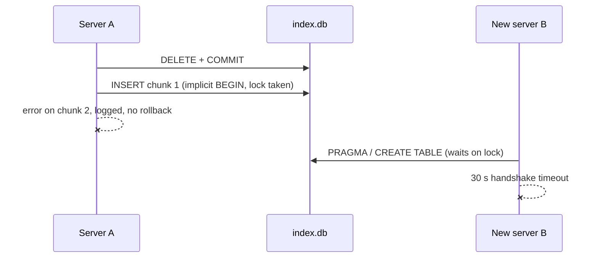

# 0.2.3

## Changes

- `workspace_search` takes an optional `path_prefix`. Only documents inside that folder (relative to the workspace root, or absolute) are returned. Use `forms` to search a form library only. The match is exact: `forms` does not match `forms_old/` or `Forms/`, and `%` and `_` are literal.
- A failed index write now rolls back. Before, an error after the first insert left the transaction open. The process then kept the write lock until it exited, and every other server on the shared index (and the start-up of each new server) waited on it. A stuck lock was seen for more than a day, and new sessions failed the 30-second MCP handshake. A failed update also kept the old rows; delete and insert are now one transaction.

**Before**


**After**
```mermaid
sequenceDiagram
    participant A as Server A
    participant DB as index.db
    participant B as New server B
    A->>DB: BEGIN; DELETE; INSERT chunk 1
    A--xA: error on chunk 2
    A->>DB: ROLLBACK (lock released, old rows kept)
    B->>DB: PRAGMA / CREATE TABLE
    B-->>B: handshake answered
```

Diff: `git diff v0.2.2..v0.2.3`.
