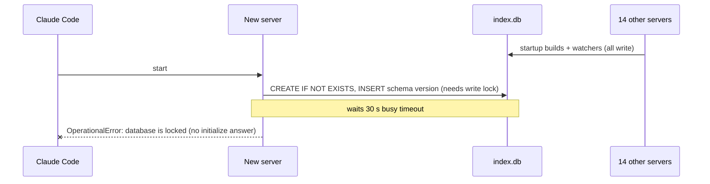
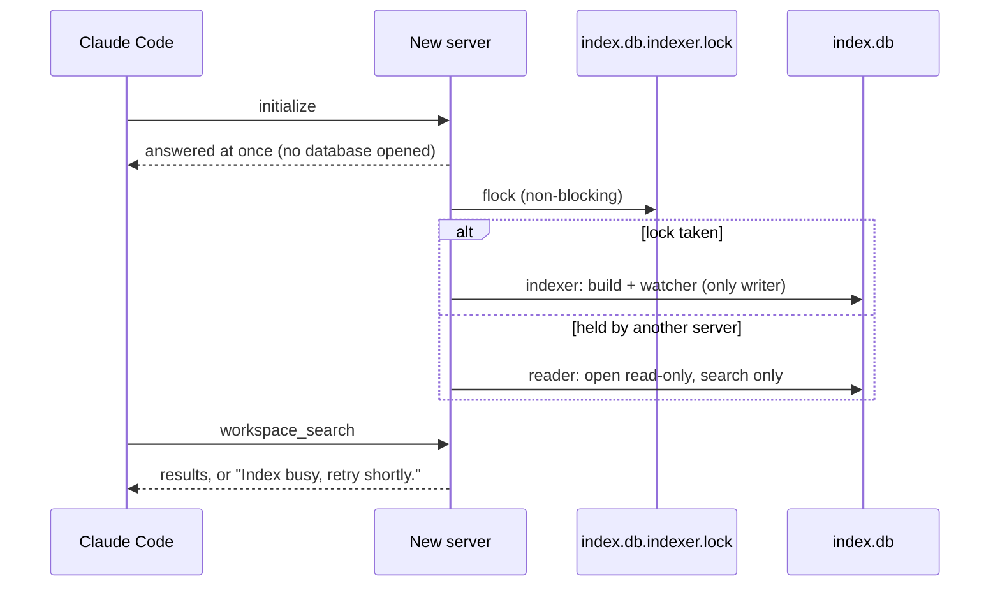

# 0.2.4

## Fix: a new server died at startup with "database is locked" (#12)

Each Claude Code session starts its own server, and all of them share one index. With about 14 running, a new server died about 34 seconds after start, before it answered `initialize`. Two causes:

1. Opening the index wrote to it on every start (create tables, store the schema version), inside the server's startup. The handshake waited on the other servers' write locks until the 30-second busy timeout expired.
2. Every server ran the full startup index build and its own file watcher. N sessions did N times the work and fought for the write lock all the time.

## Changes

- Opening an index whose schema is current is read-only. A write happens only to create or migrate the schema, with bounded retry.
- Startup opens no database. The server answers `initialize` and `tools/list` at once. A background thread opens the index and retries while it is busy. A tool call made before the index is open, or while another process holds it locked, answers "Index busy, retry shortly." instead of failing.
- One writer per index. The server that holds an exclusive `flock` on `<index>.indexer.lock` runs the build and the watcher. The others open the index read-only and only search. They retry the lock every 2 seconds, so one takes over when the indexer exits.
- `workspace_status` reports this server's `role` (`indexer` or `reader`). `workspace_reindex` runs only on the indexer.
- Index writes still commit one file at a time, so readers wait at most for one file's commit.

**Before**

**After**

## Caveat

Servers still running 0.2.3 or older do not take the lock. They keep building and writing until their sessions restart.

Diff: `git diff v0.2.3..v0.2.4`.
