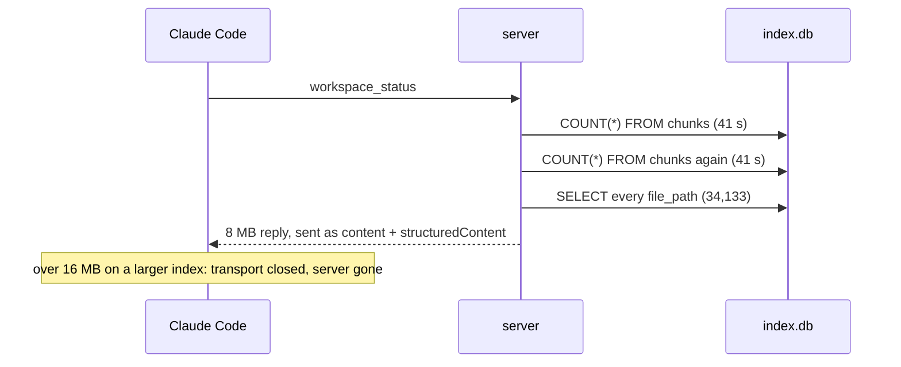

# 0.2.5

## Fix: `workspace_status` took 86 seconds and returned 8 MB, and Claude Code dropped the server (#14)

Measured 2026-11-19 on the shared index (34,133 files, 942,414 chunks):

- `workspace_status` took 86.4 s and returned 8,025,476 bytes. `chunk_count` ran `COUNT(*)` on the FTS5 `chunks` table, which scans every row, and the tool read it twice. The payload listed every indexed path, and the MCP layer sent the text twice (`content` and `structuredContent`).
- Claude Code closes a stdio server whose reply passes 16 MB ("wrote >16MB to stdout without a JSON-RPC message boundary"). After that, every tool on the server was gone for the session.
- `workspace_list_documents` returned every path too, with the same risk.

## Changes

- `chunk_count` sums `file_meta.total_chunks` instead of scanning `chunks`.
- `workspace_status` reads each count once and returns counts only. It no longer lists files.
- `workspace_list_documents` returns 500 paths per page, with `document_count`, `offset` and `next_offset` (null on the last page). It takes `offset` and `path_prefix` (one folder, as in `workspace_search`).

**Before**


**After**
```mermaid
sequenceDiagram
    participant C as Claude Code
    participant S as server
    participant DB as index.db
    C->>S: workspace_status
    S->>DB: COUNT(*) FROM file_meta; SUM(total_chunks) FROM file_meta
    S-->>C: counts only (under 4 KB)
    C->>S: workspace_list_documents(offset, path_prefix)
    S-->>C: 500 paths + next_offset
```

## Tests

`tests/test_status_bounded.py` (5 tests). All 5 were seen failing on 0.2.4 before the fix. Full suite: 35 passed.
